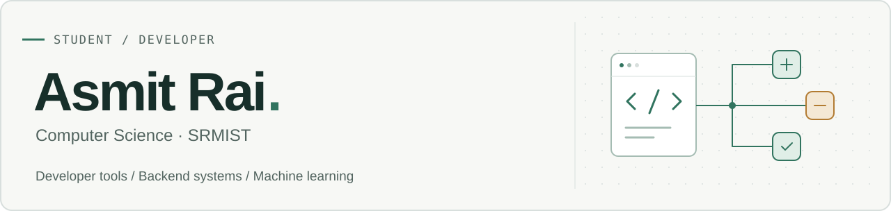

<picture>
  <source media="(prefers-color-scheme: dark)" srcset="assets/header-dark.svg">
  <source media="(prefers-color-scheme: light)" srcset="assets/header-light.svg">
  
</picture>

I'm a **B.Tech Computer Science student at SRM Institute of Science and Technology**. I like being able to look inside things: how a codebase is put together, why a model gets a prediction wrong, and what makes a backend work.

Most of my recent work here is in **Python and TypeScript**. I'm learning by building tools I would want to use myself.

[Portfolio](https://asmitrai.is-a.dev/) · [LinkedIn](https://www.linkedin.com/in/asmit-rai/) · [Email](mailto:ashmitrai12@gmail.com) · [All repositories](https://github.com/Asmit-Rai-04?tab=repositories)

## Selected work

### [RepoLens](https://github.com/Asmit-Rai-04/RepoLens)

A way to get your bearings in an unfamiliar repository. Explore its architecture, follow dependencies, spot cycles, and browse the source behind the graph.

`Python` `FastAPI` `Tree-sitter` `NetworkX` `Next.js` `TypeScript`

### [ModelXray](https://github.com/Asmit-Rai-04/modelxray)

A closer look at where tabular classifiers go wrong. Investigate weak spots and compare model versions through reproducible runs.

`Python` `scikit-learn` `pandas` `FastAPI` `Next.js` `TypeScript`

### [Traffic light colour detection](https://github.com/Asmit-Rai-04/traffic-light-detection-)

An early computer vision experiment using webcam input, HSV colour masks, and bounding boxes to detect colours.

`Python` `OpenCV` `NumPy`

## Tools I use

| Area | Tools |
| :--- | :--- |
| Languages | Python, TypeScript, JavaScript |
| Web & APIs | React, Next.js, FastAPI |
| Analysis & ML | pandas, NumPy, scikit-learn, OpenCV |
| Code & graphs | Git, Tree-sitter, NetworkX |

## What I'm working on

- Making codebase structure easier to explore in **RepoLens**.
- Understanding model failures and comparisons through **ModelXray**.
- Keeping up with **data structures and algorithms** alongside my coursework.

## Contribution snake

One part of this profile I had to keep. A snake working its way through my GitHub contributions, refreshed daily.

<picture>
  <source media="(prefers-color-scheme: dark)" srcset="https://raw.githubusercontent.com/Asmit-Rai-04/Asmit-Rai-04/output/github-contribution-grid-snake-dark.svg">
  <source media="(prefers-color-scheme: light)" srcset="https://raw.githubusercontent.com/Asmit-Rai-04/Asmit-Rai-04/output/github-contribution-grid-snake.svg">
  
</picture>

---

If you're working on developer tools or ML projects, I'd be happy to compare notes or work on something together. [Get in touch](mailto:ashmitrai12@gmail.com).
